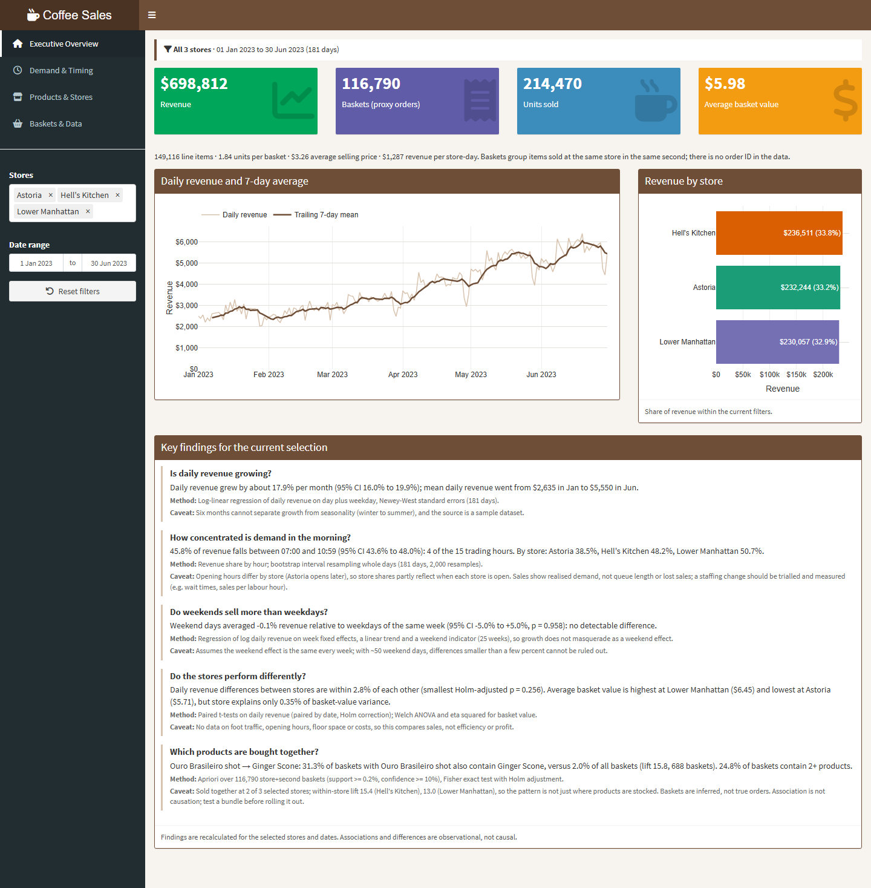
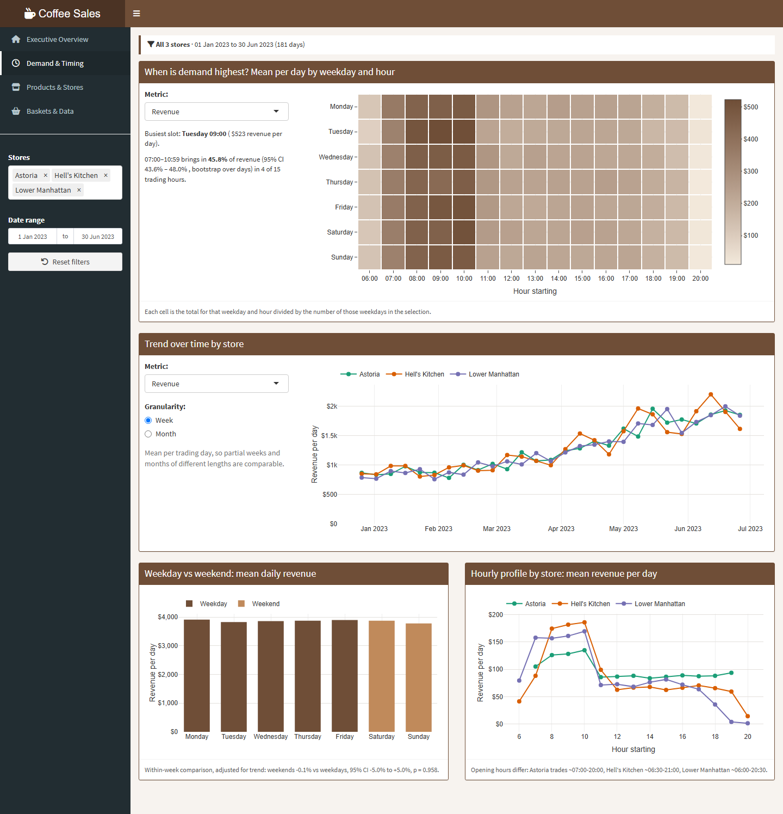
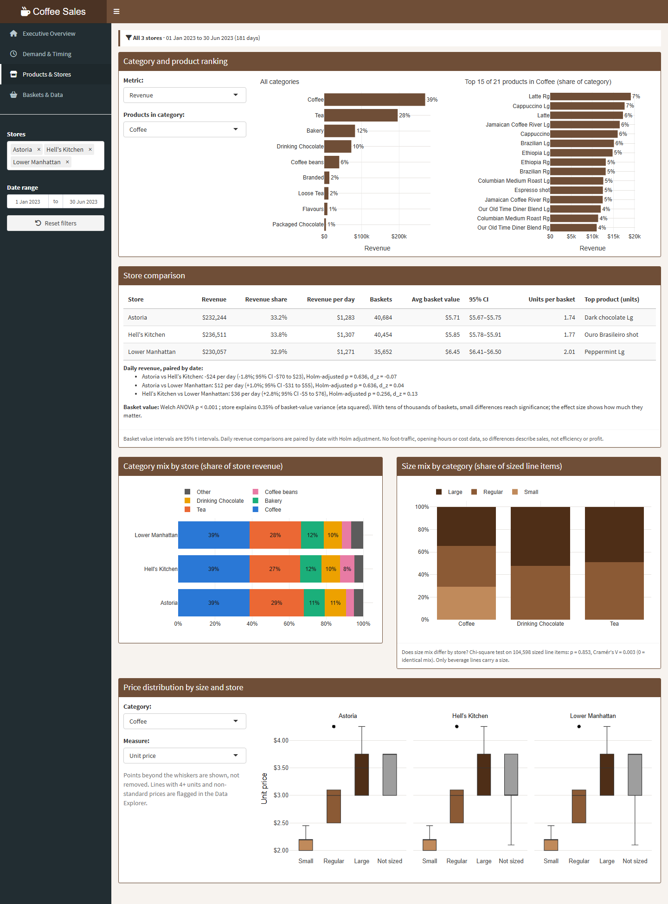
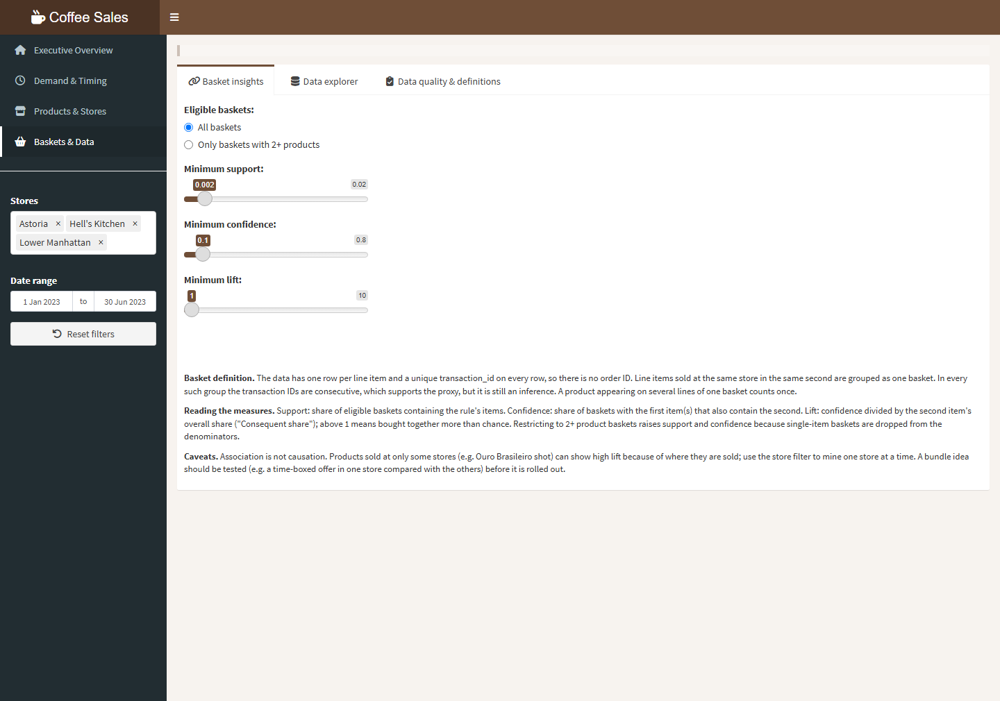
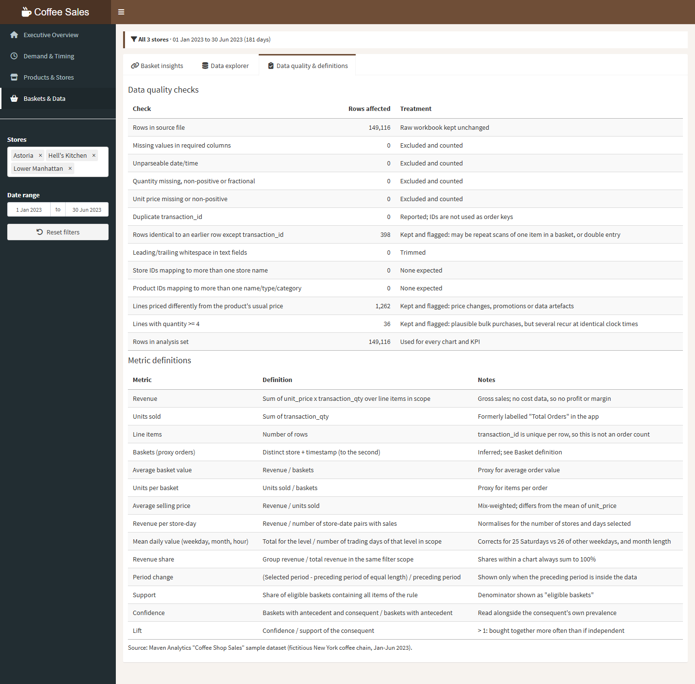
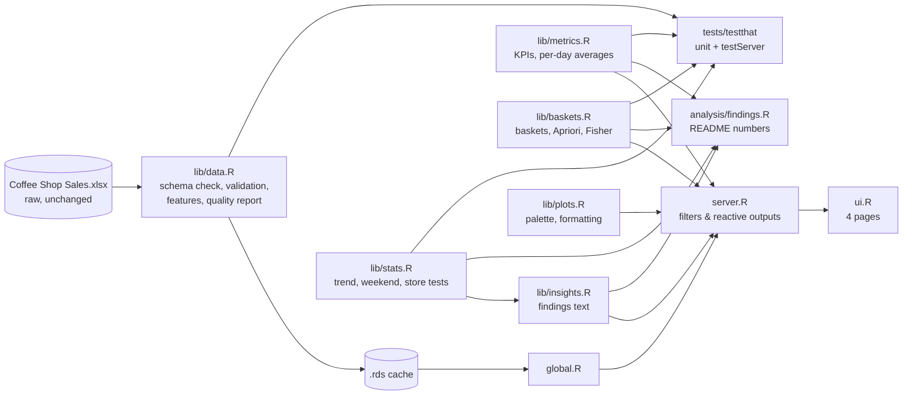

# Coffee Shop Sales: Demand, Store and Basket Analysis

An interactive R Shiny case study of 149,116 point-of-sale line items from three New York coffee
shops (January–June 2023). It answers four operational questions with validated metrics,
uncertainty estimates and tested code:

1. Is demand growing, and when does it peak?
2. Do weekends or stores behave differently once trend and exposure are accounted for?
3. What drives revenue across products, sizes and stores?
4. Which products are bought together, and how far can that be trusted?

**[Live dashboard](https://01a1346e-6b52-2994-3997-e90f07601777.share.connect.posit.cloud)**
(Posit Connect Cloud; the first load can take a few seconds while the app wakes up.)



## Business problem

A small coffee chain wants to know where its revenue comes from and when, to inform staffing,
product range and promotions. The available data is a transaction log with no costs, staffing or
customer identifiers. Part of the job is being clear about what that data can and cannot support.

## Verified findings

All numbers come from `Rscript analysis/findings.R`, which runs the same functions as the dashboard
(full output in [`docs/findings_output.txt`](docs/findings_output.txt)). The overview page
recalculates these findings for whatever stores and dates are selected.

| # | Question | Method | Result | Limitation |
|---|---|---|---|---|
| 1 | Is revenue growing? | Log-linear regression of daily revenue on day + weekday, Newey-West (HAC) standard errors, 181 days | **+17.9% per month** (95% CI 16.0%–19.9%). Mean daily revenue rose from $2,635 (Jan) to $5,550 (Jun) | Six months can't separate growth from seasonality; sample dataset |
| 2 | When is demand concentrated? | Share of revenue by hour; bootstrap CI resampling whole days | **45.8%** of revenue falls between 07:00 and 10:59 (95% CI 43.6%–48.0%), 4 of 15 trading hours. By store: Lower Manhattan 50.7%, Hell's Kitchen 48.2%, Astoria 38.5% | Stores have different opening hours; sales measure realised, not unmet, demand |
| 3 | Do weekends sell more? | Log daily revenue on week fixed effects + linear trend + weekend indicator (25 weeks) | **No detectable difference**: −0.1% (95% CI −5.0% to +5.0%, p = 0.96). Mean revenue per day ranges only $3,782 (Sun) to $3,911 (Mon) | Differences under ~5% can't be ruled out |
| 4 | Do the stores differ? | Paired t-tests on daily revenue (paired by date) with Holm correction; Welch ANOVA + η² on basket value; χ² + Cramér's V on size mix | Daily revenue within **±2.8%** across stores (all adjusted p ≥ 0.26). Lower Manhattan has the highest basket value ($6.45 vs $5.71 at Astoria; p < 0.001) but store explains only **0.35%** of basket-value variance. Size mix is the same at every store (Cramér's V = 0.003) | No foot-traffic, floor-space or cost data: this compares sales, not efficiency or profit |
| 5 | What is bought together? | Apriori over all 116,790 inferred baskets, Fisher exact test with Holm adjustment, within-store check | Of baskets with an **Ouro Brasileiro shot, 31.3% also contain a Ginger Scone**, against 2.0% of all baskets (lift 15.8, 688 baskets). The lift holds within each store that sells both (15.4 and 13.0). Flavoured syrups pair with lattes and cappuccinos (lift ~9) | Baskets are inferred; association isn't causation; 24.8% of baskets have 2+ products |

**Correction to the previous version of this README:** it stated that "72% of baskets containing
the shot also contained the scone". That figure was computed only over baskets with 2+ products.
Across all baskets containing the shot, the figure is 31.3%.

### Hypotheses worth testing (not proven by this data)

- **Morning staffing.** Lower Manhattan and Hell's Kitchen take about half their revenue between
  07:00 and 10:59. A trial adding staff in that window at one store could be evaluated on wait time,
  abandoned orders and sales per labour hour against the other stores (difference-in-differences),
  which the sales log alone can't measure.
- **Shot + scone bundle.** A time-boxed bundle at one store, compared with a matched store, would
  show whether a price incentive raises attachment above the 31% baseline or just discounts
  purchases that already happen.

## What the dashboard shows

| Page | Contents |
|---|---|
| **Executive Overview** | Revenue, baskets (proxy orders), units, average basket value, with change vs the preceding equal-length period; daily trend with 7-day mean; revenue by store; the five findings above, recalculated live |
| **Demand & Timing** | Weekday × hour heatmap (mean per day); weekly/monthly trend per trading day by store; weekday vs weekend with the trend-adjusted test; hourly profile by store |
| **Products & Stores** | Category and product rankings with shares; store comparison table with CIs and paired tests; category mix by store; size mix with χ² test; price distributions by size and store |
| **Baskets & Data** | Association rules with configurable basket definition, support, confidence and lift, plus eligible/generated/retained counts and Fisher p-values; searchable data explorer with quality flags and CSV export of exactly the rows shown; data-quality checks and metric definitions |

Store and date filters apply to every page. Each page states the active filter scope.

| Demand & Timing | Products & Stores |
|---|---|
|  |  |

| Basket insights | Data quality |
|---|---|
|  |  |

## Data

**Source:** [Maven Analytics Data Playground, "Coffee Shop Sales"](https://mavenanalytics.io/data-playground/coffee-shop-sales):
"transaction records for Maven Roasters, a fictitious coffee shop operating out of three NYC
locations". **Licence:** listed as *Public Domain* on that page (checked 13 Oct 2026). The page's
metadata ("499 records, 25 fields") does not match the workbook in this repository (149,116 rows,
11 fields), so check the current download before reusing it.

| Column | Type | Description |
|---|---|---|
| `transaction_id` | number | Unique per **row** (line item), not per order |
| `transaction_date`, `transaction_time` | date, time | Store-local date and clock time (to the second) |
| `transaction_qty` | number | Units on the line (1–8) |
| `store_id`, `store_location` | number, text | 3 stores: Astoria, Hell's Kitchen, Lower Manhattan |
| `product_id`, `product_detail` | number, text | 80 products; size is the trailing `Sm`/`Rg`/`Lg` token |
| `product_category`, `product_type` | text | 9 categories, 29 types |
| `unit_price` | number | $0.80–$45.00 |

- [Metric definitions](docs/METRICS.md)
- [Data quality report](docs/DATA_QUALITY.md): 0 invalid rows. 398 near-duplicates, 1,262
  non-standard prices and 36 high-quantity lines were kept and flagged, not deleted.
- [Initial audit of the original app](docs/AUDIT.md): 17 findings, including the metric
  mislabelling fixed here.

## Methodology

- **Grain and baskets.** One row is one line item. With no order ID, a basket is all lines at the
  same store in the same second. In every one of the 29,260 multi-line baskets the transaction IDs
  are consecutive, which supports this proxy, but it is still labelled as a proxy throughout.
- **Exposure.** Weekday, month and hour views divide by the number of trading days of each level
  (the 181 days include 25 Saturdays and 26 of every other weekday). Store comparisons use revenue
  per store-day and are paired by date.
- **Trend.** Revenue roughly doubles over the period, so comparisons across time are
  trend-adjusted. In the weekend model, week fixed effects alone would still leave growth within
  each week, and Saturday/Sunday fall at the end of a Monday-start week. A unit test with simulated
  data caught this, and a linear trend term was added.
- **Uncertainty.** HAC standard errors for the trend (daily residual autocorrelation 0.56);
  bootstrap over days for shares; paired t intervals for stores; Holm correction wherever several
  comparisons are reported together; effect sizes (η², Cramér's V, d_z) next to p-values, because
  with ~100k observations almost any difference is "significant".
- **Association rules.** Apriori (arules) over presence/absence baskets with redundant rules
  removed. Support is a share of *all* eligible baskets (configurable to 2+ product baskets). Each
  rule shows the consequent's own share and a one-sided Fisher exact test (Holm-adjusted).

## Architecture



```
Dashboard/                 deployed app (Posit Connect)
  global.R                 packages, config, data load
  ui.R / server.R          layout and reactive logic
  lib/                     data.R, metrics.R, baskets.R, stats.R, insights.R, plots.R
  manifest.json            deployment manifest (packages + file checksums)
analysis/
  findings.R               reproduces every number in this README
  coffee_sales_analysis.R  original exploratory script (kept for history; predates the metric fixes)
tests/
  testthat.R               test runner
  testthat/                data, metrics, baskets, stats, app (testServer), deploy checks
docs/                      audit, metric definitions, data-quality report, findings output, screenshots
```

## Tech stack

R 4.6 · Shiny + shinydashboard · dplyr · plotly / ggplot2 · DT · arules (Apriori) · base R `stats`
(lm, t-test, χ², bootstrap, HAC standard errors written by hand) · testthat · Posit Connect Cloud.
No SQL, database or machine-learning model is used.

## Run locally

Requires R ≥ 4.1.

```r
install.packages(c("shiny", "shinydashboard", "plotly", "dplyr", "ggplot2",
                   "readxl", "scales", "RColorBrewer", "DT", "arules"))
shiny::runApp("Dashboard")
```

The first launch reads the workbook (~5 s) and caches the cleaned data as
`Dashboard/coffee_sales_v3.rds`. Later launches read the cache. Set `COFFEE_DATA_PATH` to point the
app at another copy of the workbook.

Reproduce the findings:

```sh
Rscript analysis/findings.R      # writes docs/findings_output.txt
```

## Tests

```r
install.packages(c("testthat", "jsonlite"))
```
```sh
Rscript tests/testthat.R
```

194 expectations in 6 files:
- **Unit tests** on a hand-computed fixture cover cleaning, exclusions, flags, timestamps,
  KPIs, zero-denominator handling, per-day averages, filters, basket construction, and
  support/confidence/lift against a direct calculation.
- **Statistical tests on simulated data** check that known growth and weekend effects are
  recovered and that null effects are not.
- **Integration tests** use `shiny::testServer` on the real data. They reconcile KPIs with the raw
  workbook, check store totals, empty and invalid filters, and CSV export contents, and render
  every output.
- **Deployment checks** confirm every app file is in `manifest.json` with a matching checksum.

## Deployment

Posit Connect Cloud deploys `Dashboard/` from this repository using `Dashboard/manifest.json`. The
manifest lists every deployed file with its checksum, so regenerate it after changing any app file
(`tests/testthat/test-deploy.R` fails until you do):

```r
rsconnect::writeManifest("Dashboard", appFiles = c(
  "global.R", "ui.R", "server.R", "Coffee Shop Sales.xlsx", "www/coffee.png",
  file.path("lib", list.files("Dashboard/lib"))))
```

`.gitattributes` keeps LF line endings so the checksums match on every platform.

## Limitations

- No order ID: baskets, basket value and units per basket are proxies.
- No costs, staffing, foot traffic or opening-hours data: no profit, efficiency or capacity
  conclusions.
- Six months of data from a fictitious, likely generated dataset. Some records show templated
  patterns (see the data-quality report), so findings illustrate method rather than real-world
  effects.
- Observational data: associations and differences are not causal.

## Future improvements

1. Add a real order ID or receipt number to validate the basket proxy and measure its error rate.
2. Join staffing and opening-hours data to estimate sales per labour hour and test the
   morning-staffing hypothesis.
3. Forecast daily demand by store and hour (e.g. a seasonal model with prediction intervals,
   evaluated on a held-out month) once a longer history is available.
4. Run the bundle experiment described above and analyse it as an A/B test.
5. Move data preparation to a scheduled pipeline (e.g. DuckDB + targets) if the data grows beyond a
   single workbook.
