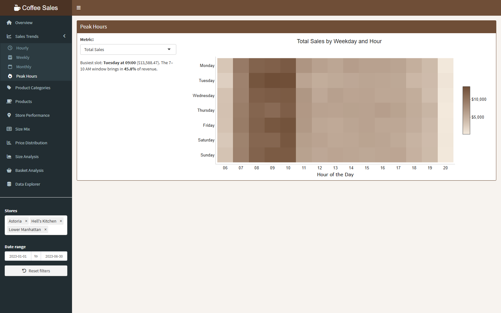
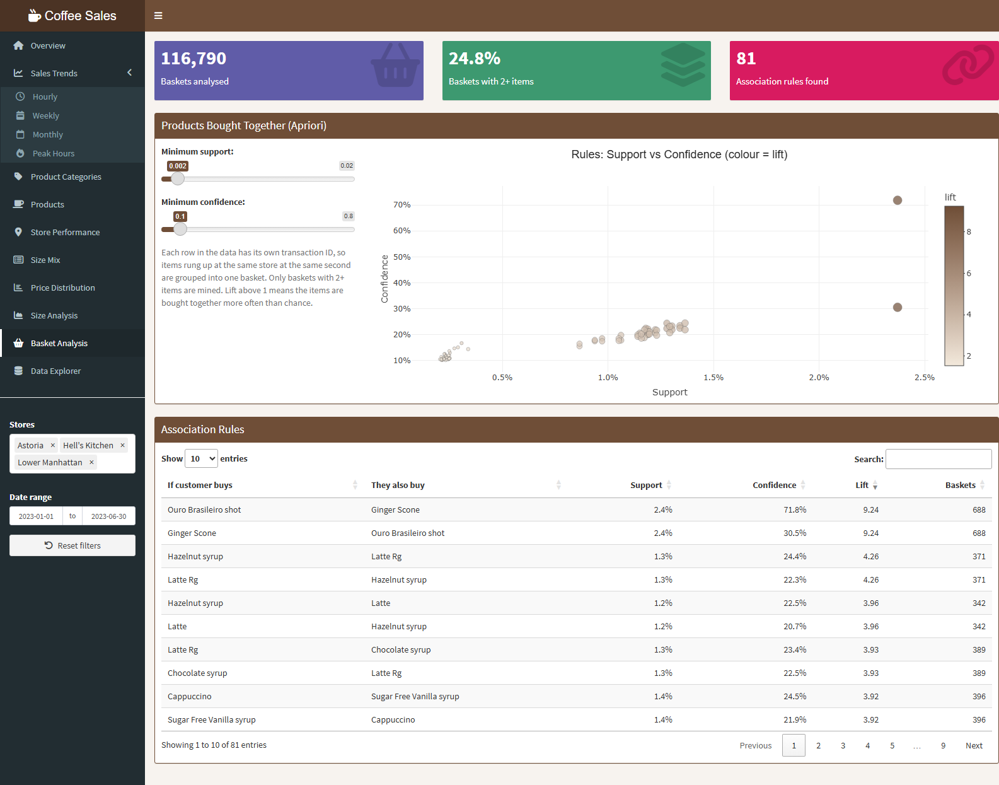
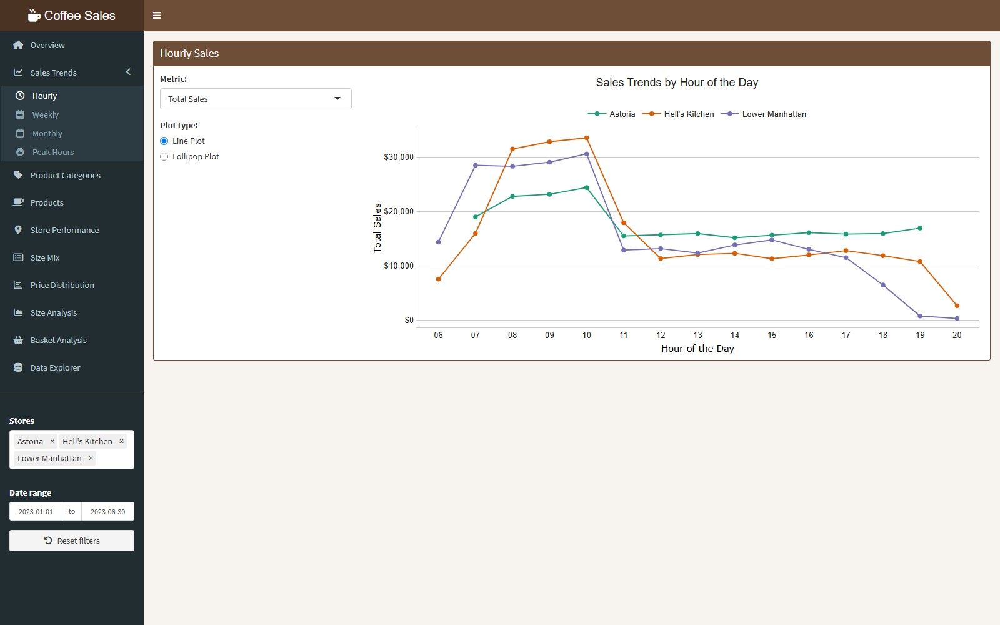
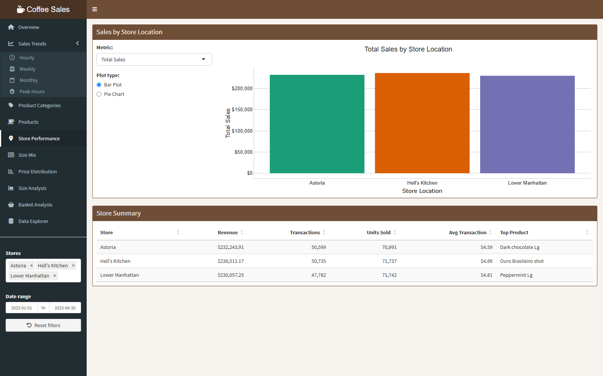

# ☕ Coffee Shop Sales Dashboard

An interactive **R Shiny** dashboard and analysis of **149,116 transactions ($698.8K revenue)** from three New York coffee shops, January–June 2023. It covers sales trends, staffing peaks, product and store performance, size and price behaviour, and **market-basket analysis** using the Apriori algorithm.


> **Live demo:** _add your shinyapps.io link here after deploying (see [Deploy](#deploy))_

**Tech:** R · Shiny · shinydashboard · plotly · ggplot2 · dplyr · arules · DT

---

## Key insights

| Insight | Evidence | Business action |
|---|---|---|
| **Revenue doubled in six months** | $81.7K in Jan → $166.5K in Jun (+104%) | Plan inventory and hiring for continued growth |
| **The morning rush drives the business** | 7–10 AM brings in **45.8%** of revenue; busiest slot is Tuesday 9 AM | Staff up for 7–10 AM; run off-peak promotions in the afternoon |
| **Coffee and tea make up two-thirds of sales** | Coffee 38.6%, Tea 28.1%, Bakery 11.8% | Protect the core beverage range; use bakery as an add-on |
| **Strong pastry cross-sell** | 72% of baskets with an *Ouro Brasileiro shot* also include a *Ginger Scone* (lift 9.2) | Bundle them as a combo or suggest the pairing at the till |
| **Syrups pair with lattes** | *Hazelnut syrup → Latte Rg* (lift 4.3) | Upsell flavoured syrups on milk drinks |
| **Stores perform evenly but differ in taste** | Each store has 33% ± 0.5% of revenue; top sellers differ (Dark Chocolate, Ouro Brasileiro, Peppermint) | Tailor the menu and promotions to each store |

## Dashboard features

- **Global filters:** a store multi-select and date range in the sidebar update every tab at once
- **Overview:** KPI tiles, daily revenue with a 7-day rolling average, store revenue share
- **Sales trends:** hourly, weekly and monthly views, plus a weekday × hour **heatmap** for staffing
- **Products and stores:** category breakdown (bar or treemap), product rankings, store summary table
- **Size and price:** size mix by category, price distributions by size and store
- **Basket analysis:** live Apriori rule mining with support/confidence sliders, a rule scatter plot and a searchable rules table
- **Data explorer:** filterable transaction table with CSV export of the current selection

| Peak hours | Basket analysis |
|---|---|
|  |  |
| **Hourly trends by store** | **Store performance** |
|  |  |

## How it works

- **Data preparation** ([global.R](Dashboard/global.R)): repairs Excel's time values, builds datetime features (hour, weekday, month) and derives drink size from the product name's `Lg`/`Rg`/`Sm` suffix. The cleaned data is cached as `.rds`, cutting startup from about 8 s to 0.2 s.
- **Reactive design** ([server.R](Dashboard/server.R)): one filtered dataset feeds every output. Basket building depends only on the filters, so moving the sliders re-mines rules without rebuilding baskets.
- **Basket definition:** every row has its own `transaction_id`, so items rung up at the same store at the same second are grouped into one basket. That gives 29K multi-item baskets for Apriori (`arules`), with redundant rules removed.
- **Testing:** every output was rendered under all control and filter combinations with `shiny::testServer`, including empty filters and thresholds that return no rules.

## Run locally

```r
install.packages(c("shiny", "shinydashboard", "plotly", "dplyr", "ggplot2",
                   "readxl", "scales", "RColorBrewer", "DT", "arules"))
shiny::runApp("Dashboard")
```

The exploratory script `analysis/coffee_sales_analysis.R` produces the static ggplot charts and the original Apriori run. Open `coffee-sales-dashboard.Rproj` first so paths resolve from the project root. It also needs `tidyverse`, `reshape2`, `corrplot`, `ggthemes`, `knitr`, `treemapify` and `arulesViz`.

## Deploy

The `Dashboard/` folder is self-contained (it includes its own copy of the data), so it can be deployed to [shinyapps.io](https://www.shinyapps.io/) as is:

```r
install.packages("rsconnect")
rsconnect::setAccountInfo(name = "<account>", token = "<token>", secret = "<secret>")
rsconnect::deployApp("Dashboard", appName = "coffee-sales-dashboard")
```

## Project structure

```
├── Dashboard/                  # Shiny app (deployable on its own)
│   ├── global.R                # Packages, data loading and caching, helpers, theme
│   ├── ui.R                    # Layout, sidebar filters, styling
│   ├── server.R                # Reactive charts, KPIs, basket analysis
│   ├── Coffee Shop Sales.xlsx  # Data
│   └── www/                    # Static assets
├── analysis/
│   └── coffee_sales_analysis.R # Exploratory analysis: static charts + Apriori
├── docs/screenshots/           # Images used in this README
└── coffee-sales-dashboard.Rproj
```

## Data

Coffee Shop Sales sample dataset (Maven Analytics): 149,116 rows and 11 columns (transaction date and time, store, product hierarchy, quantity, unit price).
